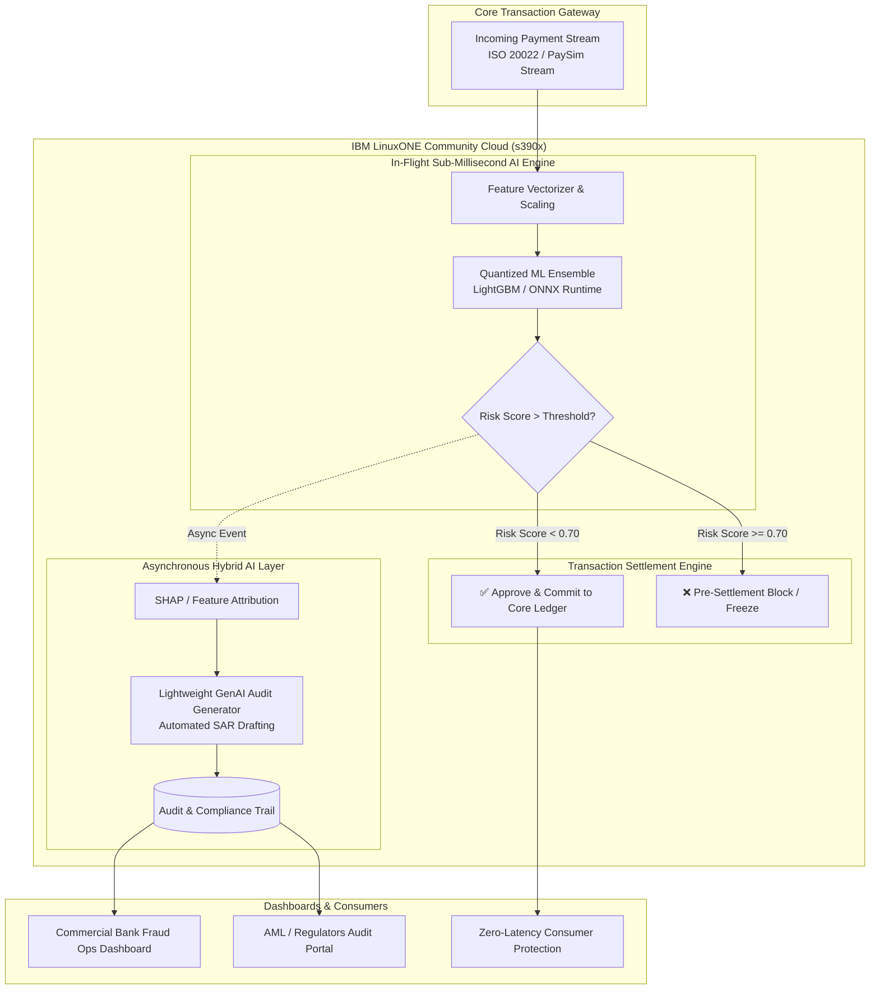

# SentinelZ: Real-Time In-Flight Fraud Prevention on IBM LinuxONE 🛡️⚡

[-006699?logo=linux)](https://linuxone.cloud.marist.edu/)

> **SentinelZ** is an enterprise-grade, in-flight transaction fraud prevention engine designed natively for **IBM LinuxONE**. It intercepts fraudulent transfers and payment scams in sub-millisecond real time before financial settlement occurs, combining low-latency predictive AI with explainable GenAI audit generation.

---

## 📌 Executive Summary

* **Theme:** Theme 1 — *Real-Time AI for Critical Decisions (Detect. Decide. Respond.)*
* **Core Problem:** Delayed post-settlement fraud engines allow illicit transfers to clear, while legacy static rules generate crippling false-positive rates.
* **Solution:** Co-locating in-flight ML inference directly on IBM LinuxONE transaction infrastructure to score streaming transactions in `< 5ms` with zero off-host network penalty.
* **AI Architecture:** **Hybrid AI** — High-speed quantized ensemble (LightGBM/XGBoost/ONNX) + Post-scoring GenAI/LLM for automated Suspicious Activity Report (SAR) narration.

---

## 🏛️ System Architecture

---

## 🚀 Key Advantages of IBM LinuxONE for SentinelZ

1. **Zero Off-Host Latency:** Traditional cloud architectures offload fraud scoring to external microservices over public WANs, adding 50–100ms of network overhead. SentinelZ runs adjacent to the transaction processor on LinuxONE, achieving sub-millisecond inference.
2. **Enterprise Concurrency (s390x):** Leverages LinuxONE's massive multi-core throughput and SIMD acceleration to process thousands of transactions per second under peak payment traffic without degradation.
3. **Pervasive Security & Isolation:** IBM LinuxONE ensures encrypted in-flight memory spaces, protecting financial transaction payloads and model weights against data exposure.

---

## 📊 Datasets Utilized

| Dataset | Sample Size | Imbalance Ratio | Primary Usage in SentinelZ |
| :--- | :--- | :--- | :--- |
| **IEEE-CIS Fraud Detection** | 590,540 rows | ~3.5% Fraud | Multi-feature behavioral scoring (device, identity, payment velocity) |
| **Credit Card Fraud (ULB)** | 284,807 rows | 0.17% Fraud | Precision-Recall (AUPRC) stress-testing under extreme class imbalance |
| **PaySim Mobile Money** | 6,362,620 rows | ~0.13% Fraud | Real-time streaming simulation & throughput benchmarking on LinuxONE |

---

## 🛠️ Technology Stack

* **Platform:** IBM LinuxONE Community Cloud (s390x architecture, JupyterLab ML environment)
* **Runtime:** Python 3.10+, ONNX Runtime / scikit-learn / LightGBM
* **Explainability & GenAI:** SHAP, Hugging Face Transformers / LangChain
* **API & Streaming:** FastAPI, Uvicorn, Streamlit (Interactive Fraud Monitoring UI)
* **Data Engineering:** Pandas, NumPy, Polars, Imbalanced-Learn

---

## 👥 Audience & Beneficiaries

1. **Commercial Banks & Payment Service Providers (PSPs):** Pre-settlement scam prevention, reduced chargebacks, drastic drop in false-positive declines.
2. **Financial Regulators & Compliance Officers:** Automated SAR creation, clear feature attribution, auditable compliance logs.
3. **Consumers & Merchants:** Immediate scam interception without friction or unwarranted card blocks.

---

## 🏆 Project Team & Links
* **Event:** IBM Z Datathon 2026 (17th–18th October, 2026)
* **GitHub Repository:** *(Add your GitHub repo link)*
* **Demo Video (Max 3 mins):** *(Add your YouTube/Vimeo unlisted link)*
